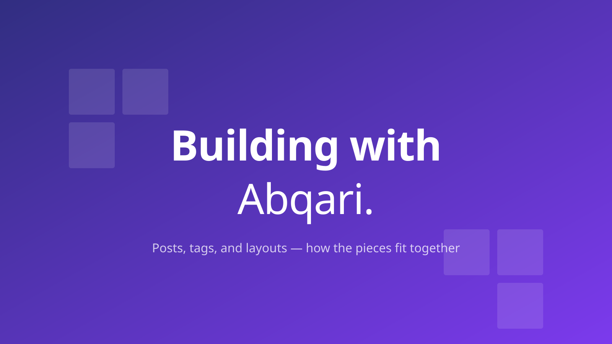

Every post on this site is a **directory under `content/posts/`**
containing an `index.md` and any colocated assets — the hero
image above lives in the same folder as the markdown that
references it.

There's no flat-file alternative for posts by default — bundles
are the single mode. (The `cookbook` collection is flat —
configured with `bundle: false` — because cookbook entries
typically don't carry assets.)

## Anatomy of a post

```
content/posts/2026-02-08-building-with-abqari/
├── index.md
├── hero.svg
└── screenshot.png
```

The `index.md` holds the post body and frontmatter:

```yaml
---
title: Building with Abqari
description: A short tour of bundles and drafts.
date: 2026-02-08
tags: [getting-started, ruby]
image: hero.svg
---

# Hello

Body content here.
```

## URLs and slugs

The directory name is everything:

- **Slug**: directory name minus the `YYYY-MM-DD-` prefix
- **Date**: from frontmatter (`date:`) or the prefix; either is fine
- **URL**: `/guides/<slug>/` (or whatever the collection's slug
  alias resolves to — defaults to `/posts/<slug>/` without the
  alias)

`content/posts/2026-02-08-building-with-abqari/` becomes
`/guides/building-with-abqari/`.

## Bundle assets are auto-resolved

Reference colocated files by their short relative name in markdown:

```markdown

[Read the docs PDF](docs.pdf)
```

At build time, Abqari:

1. Copies the asset to `_site/guides/<slug>/hero.svg`
2. Rewrites the markdown's `` to
   `/hero.svg">` (and, for raster sources,
   into a responsive `<picture>` element with AVIF + WebP variants)
3. Leaves absolute URLs (`/assets/...`), external URLs
   (`https://...`), and anchors (`#section`) alone

You write short, portable markdown; the build produces correct
HTML.

## Why bundles?

- **Co-locate post and its assets.** Delete the directory, delete
  the post and everything it owned.
- **No filename collisions.** Every post has its own asset
  namespace.
- **Editor-friendly.** Working on a post and its images in one
  folder.
- **One model.** No "which way do I do this?"

## Drafts and scheduling

`published: false` marks a post as a draft. Drafts are excluded
from production builds (no HTML, no feed entry, no sitemap entry)
and render in development with a visible amber **Draft** banner
at the top of the post.

```yaml
---
title: Work in progress
tags: [ruby, static-sites]
published: false
---
```

**Tag drafts as you would any other post.** Drafts are determined
by `published: false`, *not* a `drafts` tag. Use real subject
tags so taxonomies stay clean — your draft joins its real tag
pages the moment you publish, with no retagging.

**Publishing a draft.** Change `published: false` to
`published: true` (or just delete the line — published is the
default). The banner disappears, the post lands on `/guides/`,
joins the feed, and appears in the sitemap on the next build.

**The banner** uses `role="note"` and `aria-label="Draft notice"`
so screen readers announce it. Restyle via `.draft-banner` in
your theme CSS.

**Hide drafts in dev too.** Sometimes you want to see production
during preview — e.g. right before deploying. Set
`drafts.show_in_development: false`:

```yaml
# config/site.yml
drafts:
  show_in_development: false
```

**Force-include drafts in production**:

```bash
ABQARI_INCLUDE_DRAFTS=true bin/build
```

Useful for catching issues that only surface under real CSP,
minification, or asset fingerprinting.

### Scheduled posts

Posts with a date later than "now" are scheduled. They behave
like drafts: excluded from production until time catches up,
rendered in development with a visible blue **Scheduled** banner
that shows the exact publish moment and how far away it is.

```yaml
---
title: A coming feature
date: 2026-08-01           # naked date — uses configured timezone
tags: [features, releases]
---
```

A post can be both a draft (`published: false`) **and** scheduled
(future date) — both banners stack.

**Static sites only update on rebuild.** A post scheduled for
June 15 won't actually appear until the next build runs after
June 15. For automatic scheduled publishing, set up a daily
cron / GitHub Actions schedule:

```yaml
# .github/workflows/scheduled-build.yml
on:
  schedule:
    - cron: '0 6 * * *'      # rebuild + deploy daily at 06:00 UTC
```

**Force-include future posts**:

```bash
ABQARI_INCLUDE_FUTURE=true bin/build
```

Both env vars compose — set
`ABQARI_INCLUDE_DRAFTS=true ABQARI_INCLUDE_FUTURE=true` to render
every draft and scheduled post in a one-off prod build.

### Timezones

Naked dates in frontmatter (`date: 2026-06-15`) are interpreted
in the timezone configured in `config/site.yml`. Without this,
the same date string would mean different wall-clock moments on
different build machines.

```yaml
# config/site.yml
timezone: UTC                        # default
# timezone: Asia/Singapore
# timezone: America/Los_Angeles
```

Abqari sets `ENV['TZ']` from this config at site initialisation,
anchoring every `Time.parse` call in the build process to the
same zone. A post dated `2026-06-15` means "midnight in this
zone," everywhere.

**Dates with explicit offsets keep their offset.**
`date: 2026-06-15T09:00:00+08:00` is parsed as 09:00 SGT
regardless of `timezone:`. Use this when you want a specific
wall-clock moment in another zone.

**The scheduled banner always shows the resolved zone.** Useful
when debugging "why isn't my post live yet?"

## Customising URLs

Move posts to `/blog/<slug>/` (or any other pattern) in
`config/site.yml`:

```yaml
collections:
  posts:
    slug: blog                # → /blog/:slug/
```

Or override the full permalink template:

```yaml
collections:
  posts:
    permalink: /writing/:year/:slug/
    source: content/posts
```

Tokens: `:slug`, `:year`, `:month`, `:day`. See
[Slug aliasing](/guides/slug-aliasing/) for the URL-rename
shortcut and [Collections and taxonomies](/guides/collections/)
for the full collection-config reference.

## Listing posts

`site.posts` returns all posts sorted newest-first. Available in
any template:

```erb
<% site.posts.each do |post| %>
  <a href="<%= post.url %>"><%= post.title %></a>
  <time><%= local_time(post.date) %></time>
<% end %>
```

A landing page that lists every post is a Markdown file with
`layout: posts_index`. For collections with many entries, the
recommended pattern is the **archive split**: a curated landing
page (with the latest N posts as full cards) at `/guides/`, plus
a paginated title + date list at `/guides/archive/`. The engine
fixture has both pre-wired.

## Scaffolding a new post

```bash
bin/new post "My new post title"
```

Creates the bundle directory with today's date and a slugified
title. Open the file, write, save. Done.

The shipped `bin/new` is a small Ruby script — straight-line
code, no framework — that you can read and edit:

```ruby
def slugify(title)
  title.downcase.gsub(/[^a-z0-9]+/, '-').gsub(/\A-|-\z/, '')
end

def write_bundle(title, body: '')
  slug = slugify(title)
  dir  = File.join('content', 'posts', "#{Date.today}-#{slug}")
  FileUtils.mkdir_p(dir)
  File.write(File.join(dir, 'index.md'), <<~MD)
    ---
    title: "#{title}"
    date: #{Date.today}
    tags: []
    ---

    #{body}
  MD
end
```

Copy that into your own scaffolder if you want a different
convention (different default tags, different date format, an
optional `image:` line, etc.). The engine doesn't care how the
file got created.

## See also

- [Writing in markdown](/guides/writing-in-markdown/) — the
  markdown syntax tour
- [Collections and taxonomies](/guides/collections/) — tags,
  custom taxonomies, pagination
- [Hero images](/guides/hero-images/) — covers, placeholders,
  decorative SVG title cards
- [Co-locate images with content](/cookbook/co-located-images/) —
  the cookbook recipe
